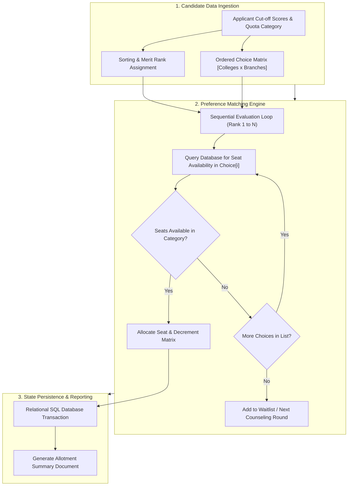

# Foundational Software Engineering & Algorithmic Projects Archive

[](https://opensource.org/licenses/MIT)
[](https://www.python.org/)
[](https://www.sqlite.org/)
[](https://github.com/Manimaran-tech/Early-coding-projects)

> **Curated archive of foundational software engineering systems, relational database models, and procedural algorithmic applications developed during secondary academic training.**

| Project Module | Domain | Core Implementation Concepts | Tech Stack |
| :--- | :--- | :--- | :--- |
| **TNEA Counseling Allocation System** | University Admissions Modeling | Priority ranking queues, preference matching, relational schema | Python, SQL, DBMS |
| **Hand Cricket Simulation Engine** | Game Theory & Logic Systems | Discrete state evaluation, pseudorandom number generators | Python Procedural CLI |
| **Retail Inventory Terminal** | Enterprise Point-of-Sale (POS) | State machines, transaction logging, inventory arrays | Python Console Application |

---

## Executive Summary

This repository archives the foundational software engineering projects that established my core competencies in programming, structured logic, and database design. Ranging from state-level admission modeling algorithms to interactive terminal applications, these projects illustrate fundamental software engineering principles: modular functional decomposition, input sanitization, database normalization, and edge-case validation.

---

## Systems Architecture & Module Breakdown

### 1. Tamil Nadu Engineering Admissions (TNEA) Counseling Simulation
The primary project implements a computational simulation of the state-level engineering counseling and seat allotment workflow in Tamil Nadu. The program processes candidate cut-off aggregate scores, resolves ranking ties, evaluates multi-tier branch preferences, and mutates dynamic seat availability matrices in a relational database.



#### Key Engineering Highlights:
- **Relational Integrity:** Implements normalized tables for colleges, branches, categories, and applicant allocations.
- **Fair Allocation Invariants:** Guarantees that higher-ranked applicants are fully evaluated before lower-ranked candidates access the seat pool.

---

### 2. Hand Cricket Game Simulation Engine
A procedural game engine simulating the popular turn-based game of Hand Cricket against an automated opponent.

#### Key Engineering Highlights:
- **Discrete Stochastic Logic:** Utilizes pseudo-random discrete integer generation to model opponent behavior.
- **State Transition Machine:** Maintains strict state transitions (Toss $\to$ First Innings $\to$ Target Setting $\to$ Second Innings $\to$ Win/Loss Evaluation).
- **Defensive Input Handling:** Sanitizes user inputs against out-of-bound numerical entries and invalid game conditions.

---

### 3. Retail Inventory & Billing Terminal
A console-based commercial point-of-sale terminal simulating retail transactions and stock level adjustments.

#### Key Engineering Highlights:
- **Inventory State Tracking:** Real-time decrementing of item quantities upon successful checkout.
- **Dynamic Ledger Formulation:** Computes aggregate sub-totals, categorical tax rates, and structured receipt generation.

---

## Technology Stack

| Layer | Tools & Methodologies |
| :--- | :--- |
| **Language** | Python 3.x |
| **Data Layer** | SQL (Structured Query Language), SQLite / MySQL |
| **Paradigm** | Procedural Programming, Algorithmic Sorting, Relational Modeling |
| **Environment** | Terminal CLI, Local DBMS |

---

## Installation & Local Execution

### 1. Prerequisites
- Python 3.7+ installed

### 2. Execution
```bash
# Clone the repository
git clone https://github.com/Manimaran-tech/Early-coding-projects.git
cd Early-coding-projects

# Run target module (e.g., TNEA simulation)
python "Tnea counseling.py"
```

---

## License

This project is licensed under the MIT License — see the [LICENSE](LICENSE) file for details.
